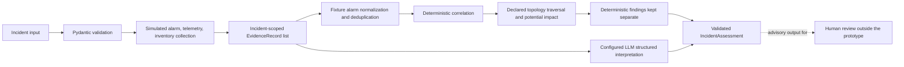
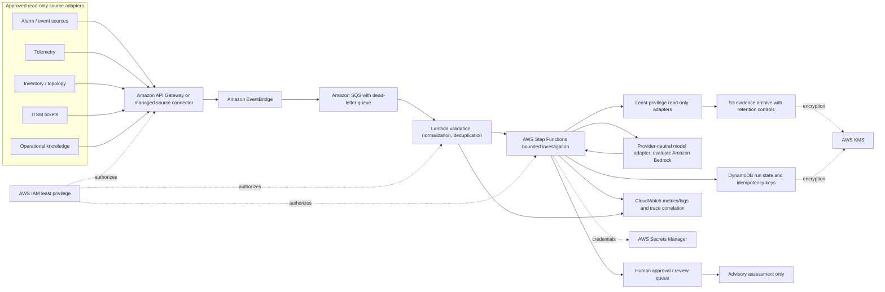

# Architecture

## Implemented current state

The following is the repository implementation: a local, synthetic-data prototype.
Solid control flow ends at an advisory assessment; there is no live source adapter,
cloud deployment, approval service, or action executor.



The Phase 2 alarm and topology path is fixture-backed for DEN-042, not a generalized
adapter pipeline. Evidence records and source references remain available with derived
results. Deterministic rules normalize, deduplicate, correlate, and traverse only
declared directed edges. The model proposes hypotheses; it does not author observed
facts. Missing or failed evidence, invalid model output, provider errors, and incomplete
topology produce explicit limitations or inconclusive results. The graph executes one
bounded pass and has no external action node.

## Proposed AWS-oriented target state (not deployed)

This is a conceptual option for a future read-only pilot. None of the AWS services below
are provisioned or integrated by this repository. Production source access, data
classification, residency, retention, identity, and operator workflow require discovery
and security review before implementation.



Service rationale: API Gateway or an approved managed connector gives a bounded
ingress boundary; EventBridge and SQS decouple event arrival, absorb bursts, and expose
failed messages through a dead-letter queue; Lambda is suitable for small stateless
validation and normalization steps; Step Functions makes workflow state, retries, and
terminal branches explicit; S3 can retain versioned evidence snapshots while DynamoDB
can hold run metadata and idempotency state; CloudWatch provides operational metrics and
logs; IAM, KMS, and Secrets Manager provide authorization, encryption-key, and secret
controls; Bedrock is only a candidate managed model endpoint behind the existing
provider-neutral boundary. Selection remains subject to latency, residency, cost, data
sensitivity, and model-quality evaluation. RAG/vector storage is not proposed as a
default; add it only if evaluated retrieval needs justify it.

The target boundary ends at a human-reviewed recommendation. An execution/remediation
adapter is intentionally absent. Before any future operational action, define a separate
authorization process, approver identity, audit trail, idempotency, rollback, and
verification controls. Human review in this diagram is a proposed integration point,
not an implemented approval workflow.

## Data, control, and security considerations

- **Flow and contracts:** `Incident` is validated at intake; collection creates
  incident/site-scoped `EvidenceRecord`s; normalized events, deduplication results,
  correlation groups, topology snapshots/paths, and assessments use typed Pydantic
  contracts. Derived objects retain original event, source-record, edge, and evidence
  references where the source supplies them.
- **Uncertainty:** successful empty results differ from missing or failed collection.
  A missing path under partial topology is unknown; a declared path implies only
  potential dependency. Service impact remains unknown without independent health
  evidence. Correlation is an explainable relationship, not root-cause proof.
- **Model boundary:** deterministic code owns validation, event identity, deduplication,
  correlation, path traversal, and evidence-grounded observed findings. The model can
  provide separate hypotheses and recommendations. Confidence is uncalibrated, and
  conflict suggestions are labelled as unverified model proposals.
- **Human boundary:** recommendations are advisory. Risk and approval metadata are
  present, but neither an approval workflow nor execution capability exists.
- **Current security posture:** fixtures are synthetic and execution is local/offline
  for evaluation. No production endpoints or credentials are configured by the demo.
  The repository does not implement cloud IAM, KMS, managed secret storage, retention
  enforcement, centralized audit, or a production logging/trace platform. Do not put
  secrets or sensitive customer data in fixtures or logs.
- **Proposed controls:** use least-privilege read-only source roles, secret rotation,
  encryption in transit/at rest, data minimization and retention limits, redacted
  structured logs, correlated run IDs, access auditing, cost quotas, bounded retries,
  dead-letter handling, human review, and deterministic evaluation gates. These remain
  target design considerations, not shipped controls.

## Prioritized use cases and roadmap

| Priority | Use case | Current readiness | Next evidence needed |
|---|---|---|---|
| 1 | Explainable alarm deduplication and correlation for one synthetic site | Implemented as deterministic fixture-backed logic and tested; no live alarm adapter | Validate source identity/time semantics and labels against representative approved data |
| 2 | Incident triage with provenance, topology path, uncertainty, and safe recommendation | Implemented as a bounded synthetic graph path for DEN-042 | Broader site coverage, independent service-health observations, and operator review |
| 3 | Ticket and knowledge context enrichment | Ticket context appears only as an evaluation-injected record; no product adapter or knowledge retrieval | Agree on access, freshness, ownership, and conflict rules; evaluate a read-only adapter |
| 4 | Human-approved operational action | Recommendation metadata only; no approval or execution flow | Separate safety case and approval design; remains outside this MVP |

Roadmap: (1) accepted local assessment and deterministic event foundations; (2) bounded
synthetic graph integration; (3) labelled offline evaluation; (4) this operational
reporting and architecture package; then stop for review. A later pilot would first
validate data contracts and read-only adapters, then security/observability controls,
then human-reviewed operational trials. Cloud deployment, RAG, UI, and remediation are
optional future decisions and are not part of current acceptance.

## Current bounded investigation flow

```text
Incident dictionary
       |
       v
Pydantic Incident validation
       |
       v
Simulated alarm / telemetry / inventory lookups
       |
       v
EvidenceRecord list (stable IDs, source, status, synthetic limitation)
       |
       v
Fixture-only alarm normalization, deduplication, correlation, and declared-topology analysis
       |
       v
LLM structured interpretation (hypotheses only)
       |
       v
Validated IncidentAssessment
```

`app.graph.build_graph()` creates the LangGraph flow. Invoke it with
`{"incident": { ... }}` using the `Incident` input contract; the final state contains
an `IncidentAssessment` object at `assessment`, collected evidence, and typed Phase 2
analysis results when the DEN-042 fixtures are available.
The CLI readiness command only initializes the graph. `python -m app.main --demo`
runs a deterministic offline stub through the same validation and collection path;
its output is labelled `demo_stub`. `--demo-ollama` runs the model-backed path.

## Domain and evidence contracts

`Incident` requires `incident_id`, `site`, `technology`, `severity`, and `description`.
Optional `occurred_at` (ISO-compatible), `affected_service`, and `related_event_refs`
are accepted. Unknown fields and empty or oversized values are rejected before
collection begins.

`EvidenceRecord` includes a stable evidence ID, source/tool name, evidence type,
incident/site references, timestamp availability, source result, collection status,
and limitation. The current hard-coded values are synthetic fixtures and have no
observation timestamps. A valid empty alarm list is a successful no-alarms result.
Explicit source error payloads are missing data; malformed or unexpectedly empty
results are failures; exceptions are failures. Inventory results must name the
requested site. Records are kept attached to the final assessment.

The sole `IncidentAssessment` contract is versioned (`1.0`). It has deterministic
observed-fact findings, separate model-authored hypotheses, evidence references,
missing sources, conflicts, open questions, confidence, uncertainty, and investigative
next steps. Model output is parsed into an `AssessmentDraft`; output citing an ID that
was not successfully collected becomes an explicit inconclusive assessment. A model
failure or invalid output also becomes inconclusive and records its generation status.
The model cannot supply or alter the attached evidence records. Preconstructed
Pydantic responses are converted back to plain data and revalidated. The assessment
model verifies evidence ownership, uniqueness, successful status, and references.
Model-proposed conflicts carry `unverified_model_proposal`; the prototype does not
deterministically establish disagreement. Confidence is an uncalibrated model-reported
0–1 score, not a probability. A supported hypothesis below the 0.5 gate is retained,
but the overall assessment remains inconclusive; the gate is not a validated
operational metric.

Advisory metadata includes the recommended action, rationale, risk, recommendation type,
and human-approval requirement. Operational or MEDIUM/HIGH-risk recommendations are
always marked as requiring approval. This is metadata only: no approval workflow or
external action is implemented.

## Simulated tools and current boundaries

The graph collects data from `get_site_alarms_data`, `get_site_telemetry_data`, and
`get_network_path_data`. These functions read local hard-coded dictionaries. There are
no connected ticket or knowledge tools, no live telecom endpoints, and no write-capable
remediation tool in this graph. No infrastructure changes are executed.

The string-only alarm tool and flat inventory dictionary remain Phase 1 evidence; they
are not reinterpreted as structured events or topology. A separate deterministic graph
node analyzes the explicit DEN-042 fixtures. Recommendations do not execute actions.

### Phase 2A alarm processing foundation

`app.alarm_processing` provides standalone normalization and deterministic
deduplication over structured alarm records. The Phase 2A fixture is explicitly
synthetic and lives in `data/alarms/phase2a_events.json`; it does not change the
existing alarm tool or assessment graph. The current alarm tool returns only alarm
code strings, so it cannot provide per-event IDs, element IDs, severity, lifecycle,
or timestamps for normalization.

The normalized model preserves the source event ID and source record ID when present,
the input row position as a locator (not an event ID), the supplied evidence ID, and
the untouched source row. Missing timestamps or fingerprint fields mark an event as
limited and prevent deduplication. Malformed rows are retained as explicit validation
issues with their original payload. No event IDs or timestamps are inferred.
Envelope-level errors have no row locator; malformed items inside an alarm list retain
their actual input index. Empty input produces zero input/valid/operational/suppressed/
invalid counts. Malformed rows contribute to the invalid count but are not counted as
suppressed duplicates.

Deduplication uses a configurable five-minute window. Matching requires timezone-aware
timestamps and all identity fields (source, site, element, event code, event type,
severity, and lifecycle state). When source event IDs exist, they must also match;
otherwise the canonical identity fields form the fallback fingerprint. The window is
anchored at the earliest representative and is not extended by repeats. If timestamps
tie, the first input row is the representative. A duplicate
group records its rule/fingerprint, representative, every original event/evidence
reference, input count, and suppressed count. All valid normalized events and invalid
source rows remain in the result; the operational view contains only representatives.
Run counts distinguish original rows, operational representatives, suppressed repeats,
and rows that failed normalization.
Phase 2D uses a separate dedicated structured alarm fixture in the graph; the Phase 2A
fixture remains available for standalone processing tests.

### Phase 2B standalone alarm correlation

`app.alarm_correlation.correlate_alarms` consumes a validated deduplication result and
emits a validated `AlarmCorrelationResult`. Its initial conservative rule groups only
complete, timezone-aware operational events that have distinct, non-empty source event
IDs and exactly match on source, site, element, event code, event type, severity, and
lifecycle state. Groups use an anchored, configurable 15-minute window. A source event
ID is required so records without source identity are not asserted to be separate
alarms; same site or nearby timestamps alone never qualify. Events outside the window,
with missing identity/time, or with any contradictory matching attribute remain
explicitly uncorrelated.

Correlation is separate from duplicate suppression: duplicate representatives carry
references to every source row and evidence record they represent, while distinct source
event IDs stay separate operational events and may be related by the recurrence rule.
Group IDs are stable hashes of the rule's shared attributes, sorted source event IDs,
and UTC time bounds. Each group records the matching attributes, exact time span and
window, member references, concise rule explanation, deterministic-match label, and
flags stating that broader context is incomplete. The group describes a repeated alarm
condition only; it does not identify a root cause, topology path, or service impact.
The normalized alarm contract has no technology or topology-edge field, so neither is
invented or used as a correlation attribute.

The positive correlation fixture is synthetic and explicit. The current Phase 1 alarm
tool returns alarm-code strings and has no source event IDs, per-event element identity,
severity, lifecycle, or timestamps. Therefore this correlation module remains a
standalone fixture-backed foundation; Phase 2D invokes it on a dedicated structured
fixture, not the string-only Phase 1 alarm tool output.

### Phase 2C standalone topology analysis

`app.models.topology` defines synthetic network elements, directed dependency edges,
service-to-element mappings, topology coverage, and traversed path references.
`app.topology_analysis.analyze_topology` traverses only declared edges. Edges point from
provider to dependent element; breadth-first traversal chooses a shortest path, breaking
equal-length ties by the lexicographically first edge-ID sequence. The result preserves
each traversed edge ID, source record ID, and
evidence ID. Missing edge endpoints, duplicate edges, and cyclic dependency graphs are
rejected during snapshot validation. Analysis-result validation independently checks
declared reachability before accepting connected, disconnected, or service no-path
statuses; valid supplied paths must match declared directed edges and provenance.

The fixture in `data/topology/phase2c_den042.json` explicitly declares a synthetic
backhaul → router → interface → cell chain, an isolated branch, and a service mapping.
Those relationships are fixture assertions and are not inferred from the existing flat
inventory dictionary or element names. Its `complete` coverage applies only to the
small synthetic graph represented by that fixture, not to a real network. A partial
snapshot must list known gaps. With partial coverage, a missing path is `unknown`; only a
complete fixture can support the narrower statement that no declared dependency path
exists.

Service analysis reports `potentially_affected` only when an affected element has a
declared directed path to an explicitly mapped service element. This is dependency
reachability, not confirmation of a customer or service outage: `observed_impact` stays
`unknown` because this standalone fixture contains no service-health observation.
Missing affected elements, missing mappings, empty affected-element input, and partial
topology remain explicit unknowns. Phase 2D invokes this module on the explicit DEN-042
fixture; it makes no root-cause or remediation decision.

### Phase 2D graph integration

The graph runs one bounded deterministic node after simulated evidence collection. For
DEN-042 it loads `data/alarms/phase2d_integration_events.json`, attaches an
incident-scoped evidence record, then runs normalization, deduplication, correlation,
and the Phase 2C declared-topology analysis. Original event IDs, source-record locators,
evidence references, duplicate-group members, correlation members, and topology edge
provenance remain in their typed results. A separate `deterministic_findings` state
field carries correlation and potential-impact interpretations; these are not placed
in assessment observed-fact findings or model-authored hypotheses. A topology path
never changes `observed_impact` from `unknown`.

Non-DEN-042 incidents expose `phase2_status="fixture_unavailable"` and retain the
existing assessment path without claiming Phase 2 results. Fixture or component failure
is recorded as failed evidence and stops assessment generation with an inconclusive
result. The analysis is local and deterministic; it adds no graph loops, external
telecom integration, write operations, or remediation.

The end-to-end Case A walkthrough uses two source rows for `SRC-EVT-DUP-1`, a distinct
`SRC-EVT-CORR-2` router event, and a separate interface-error event. One repeat is
suppressed operationally while both source-row references remain available. Correlation
relates only qualifying distinct router events; the interface alarm remains separate.
Synthetic DEN-042 telemetry records 18.2% packet loss and 247 ms latency, while the
topology fixture declares the router → interface → cell → service path. These are
fixture observations and a declared dependency path, respectively. The leading
backhaul-performance hypothesis is model-authored and evidence-referenced, not confirmed
root cause. The safe recommendation is to review counters and collect independent
service-health evidence. No corrective action is performed. A minor radio-link alarm
without a source event ID remains separate and is not promoted into the correlated
group.

## Tests and demo

Run the deterministic suite without Ollama:

```bash
PYTHONDONTWRITEBYTECODE=1 .venv/bin/python -m pytest -p no:cacheprovider
```

The optional `tests/test_agent.py` integration test requires
`NOC_RUN_OLLAMA_INTEGRATION=1`, a running Ollama service, and the configured model.
Run the offline end-to-end synthetic example with:

```bash
PYTHONDONTWRITEBYTECODE=1 .venv/bin/python -m app.main --demo
```

### Evaluation harness

Run the fixed seven-case synthetic suite and print a machine-readable JSON report:

```bash
PYTHONDONTWRITEBYTECODE=1 .venv/bin/python -m app.evaluation --no-runtime
```

Omit `--no-runtime` to include observed process runtime, or use `--output report.json`
to also save the JSON report. Timing is machine-dependent and is not a repeatable
quality metric or operational MTTR. The scenario manifest is
`data/evaluation/scenarios.json`; cases cover correlated alarms, duplicate suppression,
unrelated alarms, incomplete topology, conflicting evidence, tool/provider failure, and
low evidence. Case F runs separate tool and provider failure subcases.

Alarm counts report input, representatives, suppressed records, and suppression rate
(`suppressed / input`) with the aggregate denominator documented in the result.
Correlation precision/recall are labelled event-pair counts against only the synthetic
scenario labels. Evidence grounding measures whether structured claims cite known,
successfully collected evidence IDs; it does not establish the semantic truth of a claim.
`diagnosis_support` counts case-specific assertions that a leading hypothesis cites
expected successful fixture evidence. Diagnosis truth and semantic quality remain
unscored. The report distinguishes failed expected checks, tool-error records, unavailable
evidence records, provider failures, validation failures, and valid inconclusive
assessments. An inconclusive result is not automatically a failed scenario; the labelled
checks determine scenario pass/fail. Approval/risk checks and zero external actions are
reported separately.

Ticket records in Cases A and E are injected as clearly labelled evaluation-only
`EvidenceRecord`s. The product graph still has no ticket adapter; those cases do not
demonstrate a ticket integration. All case data and LLM responses are synthetic and
offline. Results describe this small test set only; they are not production accuracy,
MTTR, or business-impact claims.

## Deferred work

Remaining gaps include broader site fixture coverage, independent service-health
evidence, product adapters for ticket and knowledge sources, centralized run tracing,
cloud security controls, and operator usability validation. The evaluation report is a
repeatable synthetic test report, not production observability or an operational NOC
dashboard.
The offline demo stub is for reproducibility; it is not evidence of model quality or
operational diagnosis.
